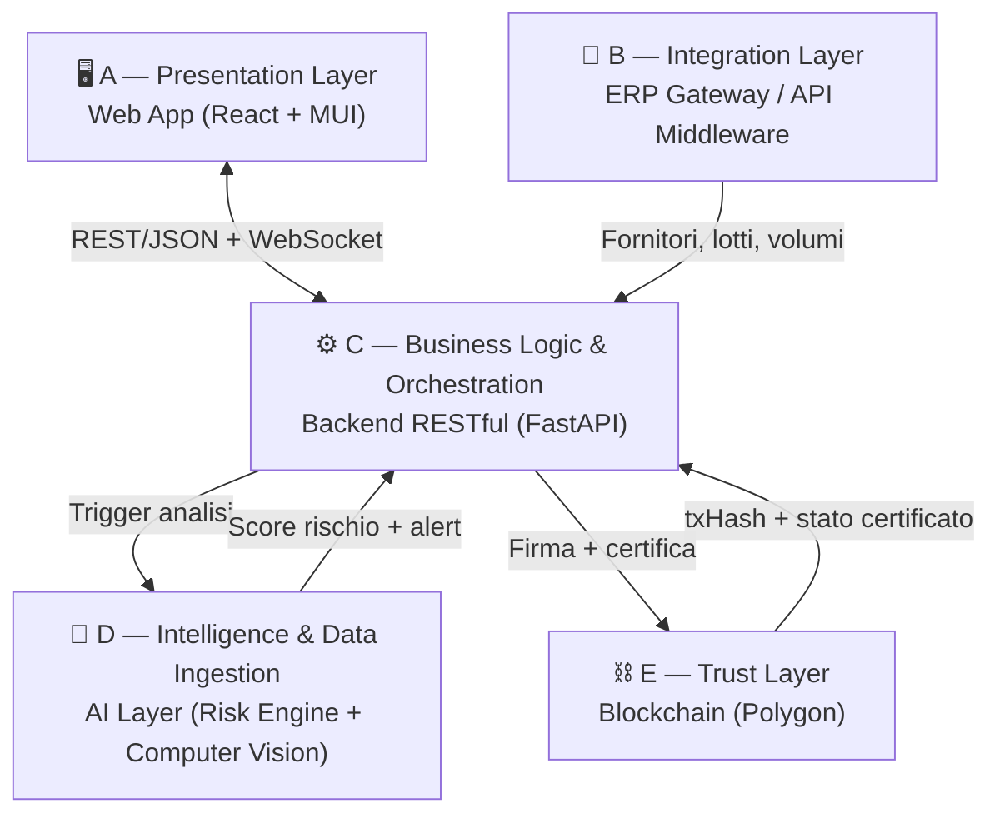
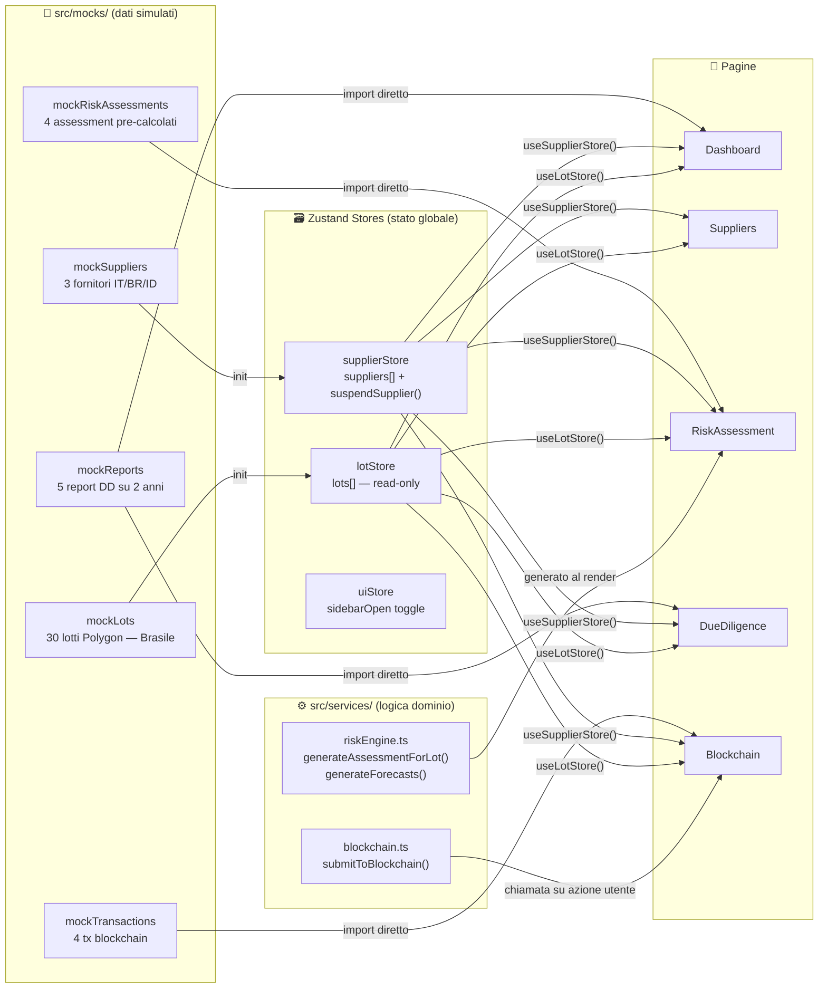
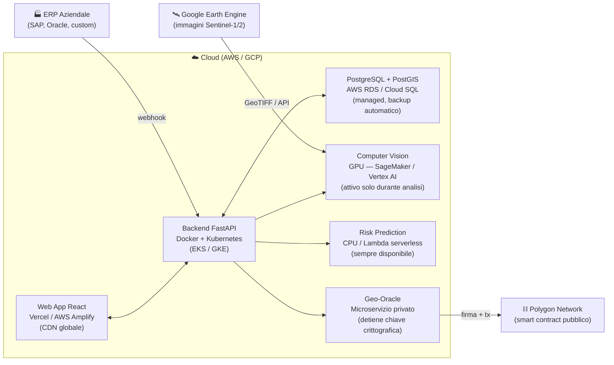

# Farm Roots — Architettura del Sistema

---

## 1. I cinque macro-livelli

L'architettura è strutturata in cinque livelli che collaborano in modo **asincrono** per non appesantire l'esperienza utente sulla dashboard.

### A. Presentation Layer (Frontend)
È l'interfaccia con cui interagisce l'azienda.
- **Componente**: Web App
- **Funzioni**: visualizzazione mappa lotti (GeoJSON), gestione alert Red/Green, caricamento manuale fornitori, reportistica EUDR.

### B. Integration Layer (ERP Gateway)
Il ponte verso il mondo esterno.
- **Componente**: Middleware di integrazione (API Gateway)
- **Funzioni**: si collega via API o Webhook ai gestionali aziendali (SAP, Oracle, ecc.) per importare automaticamente l'anagrafica fornitori, le coordinate dei lotti e i volumi di merce.

### C. Business Logic & Orchestration (Backend)
Il "cervello" che coordina le operazioni.
- **Componente**: RESTful API (FastAPI)
- **Funzioni**: gestisce autenticazione, logica dei tier di abbonamento, e coordina le chiamate verso i moduli AI e la Blockchain.

### D. Intelligence & Data Ingestion (AI Layer)
Dove avviene la magia del monitoraggio.
- **Modulo Change Detection**: ingerisce dati Sentinel-1/2 e usa reti neurali (U-Net) per classificare il terreno e rilevare deforestazione.
- **Modulo Risk Prediction**: analizza trend storici e dati di prossimità per prevedere rischi futuri su 30/60/90 giorni.

### E. Trust Layer (Blockchain)
Garantisce la prova legale dell'audit.
- **Componente**: Geo-Oracle + Smart Contracts su Polygon
- **Funzioni**: firma digitale dei verdetti AI, creazione di certificati immutabili, blocco automatico dei lotti RED.

---

## 2. Stack tecnologico

| Componente | Tecnologia | Motivazione |
|------------|-----------|-------------|
| Frontend | React + TypeScript + MUI | Reattività, ecosistema vasto, librerie cartografiche (MapLibre GL) |
| Backend | Python — FastAPI | Linguaggio standard per AI; comunicazione nativa con modelli CV |
| Database primario | PostgreSQL + PostGIS | Gestione dati geografici, poligoni e query spaziali (GeoJSON) |
| Cache & code | Redis | Job asincroni Celery, cache API, WebSocket real-time |
| AI Framework | PyTorch / TensorFlow | Rete U-Net per segmentazione immagini satellitari |
| Data Engine | Google Earth Engine API | Ingestione e pre-processing immagini Sentinel-1/2 |
| Blockchain | Polygon (Layer 2) | Gas fee bassi, alta velocità per generazione certificati |
| Auth | OAuth2/OIDC (Keycloak) | SSO aziendale, integrazione Azure AD / Google Workspace |

---

## 3. Come si muovono i dati (stato attuale — MVP)

Nel prototipo attuale il backend non esiste ancora: tutti i dati vengono da **mock locali** nel frontend. La struttura è progettata per sostituire i mock con chiamate API reali senza toccare i componenti.

**Regola semplice:**
- Dati **mutabili** (suppliers, lots) → Zustand store → tutti i componenti si aggiornano automaticamente
- Dati **storici** (reports, transactions) → import diretto da mocks → no stato globale necessario
- Dati **derivati** (forecast, assessment dinamici) → calcolati al render da `riskEngine.ts`

---

## 4. Risk Engine — 8 criteri EUDR

Il `riskEngine.ts` implementa il cuore del prodotto: scoring, forecasting e rationale in italiano.

| ID | Criterio | Peso |
|----|---------|------|
| c01 | Deforestazione aree adiacenti | 0.20 |
| c02 | Rischio paese (rating EUDR CE) | 0.18 |
| c03 | Cambio uso suolo post 31/12/2020 | 0.15 |
| c04 | Storico compliance fornitore | 0.12 |
| c05 | Qualità dati geolocalizzazione | 0.08 |
| c06 | Copertura forestale nel lotto | 0.08 |
| c07 | Prossimità aree protette IUCN | 0.07 |
| c08 | Sovrapposizione terre indigene | 0.05 |

**Soglie risk level**: score < 33 → 🟢 Basso · 33–65 → 🟡 Medio · ≥ 66 → 🔴 Alto

**Forecast 30/60/90 giorni**: per ogni criterio calcola drift ambientale stagionale + riduzione da azioni di mitigazione in corso, e genera una spiegazione testuale in italiano.

---

## 5. Deployment: dove gira ogni pezzo

- **Web App**: Vercel o AWS Amplify — distribuzione globale via CDN.
- **Backend + DB**: containerizzati Docker, orchestrati Kubernetes; PostgreSQL come istanza managed per backup e HA.
- **Computer Vision** (pesante): GPU on-demand su SageMaker / Vertex AI — si attiva solo durante l'analisi delle immagini.
- **Risk Prediction**: istanze CPU standard o Lambda serverless se il modello è leggero.
- **Geo-Oracle**: microservizio privato nel backend — detiene la chiave crittografica e firma i pacchetti prima di inviarli su Polygon.
- **Smart Contract**: risiede sulla rete Polygon pubblica — verificabile da chiunque.

---

## 6. MVP ora vs. target v1.0

| Layer | Oggi (prototipo) | v1.0 |
|-------|-----------------|------|
| Frontend | React + TS + MUI — funzionante | Invariato |
| Dati | Mock locali in-browser | FastAPI + PostgreSQL |
| AI / Risk | Scoring deterministico (riskEngine.ts) | Modelli ML su dati Sentinel reali |
| Blockchain | Hash simulati | Polygon mainnet via ethers.js |
| ERP | — | Webhook REST (SAP, Oracle, custom) |
| Auth | — | OAuth2/OIDC (Keycloak / Azure AD) |
| Deployment | `npm run dev` locale | Kubernetes cloud EU |
