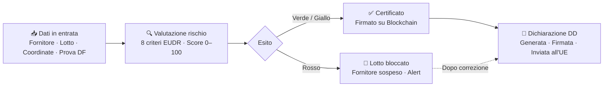

# I dati di Farm Roots

## Cosa entra nel sistema

| Sorgente | Dato | Come arriva |
|----------|------|-------------|
| Azienda / ERP | Fornitori, lotti, quantità, date di raccolta | Importazione automatica o inserimento manuale |
| Fornitore | Coordinate GPS del terreno (GeoJSON) | Caricamento diretto |
| Fornitore | Prova che il lotto è deforestation-free | Upload documento |
| Satellite (Sentinel, GFW) | Immagini del terreno, variazioni di copertura forestale | API automatica |

---

## Come i dati si trasformano

---

## Cosa esce dal sistema

| Output | Destinatario | Valore |
|--------|-------------|--------|
| **Certificato di conformità** | Blockchain pubblica (Polygon) | Prova immutabile, verificabile da chiunque |
| **Alert di blocco** | Azienda in tempo reale | Reazione immediata, zero sorprese |
| **Dichiarazione di Due Diligence** | Sistema ufficiale EU (EUDR-IS) | Compliance normativa completata |
| **Forecast rischio 30/60/90 giorni** | Azienda | Decisioni proattive sui fornitori |

---

## Il dato critico: la conformità del lotto

Ogni lotto può trovarsi in uno di tre stati:

- ✅ **DF-free** — ha la prova documentale e nessuna deforestazione rilevata → entra nel risk assessment
- ⚠️ **Prova mancante** — nessun documento caricato → escluso, richiede azione
- 🔴 **Deforestazione rilevata** — satellite o audit ha rilevato deforestazione → bloccato automaticamente
